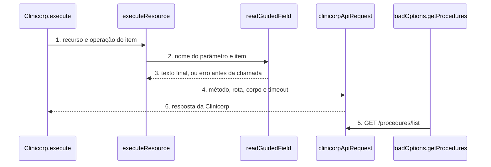

# Clinicorp: node-cli 0.55 e campos guiados (versão 2 do node)

**Approved**: 2026-11-06 - user: "Aprovo com antecedência (Recomendado · Jev 0,96)"

> Build this with **tlc-implement**. Every criterion becomes a check with a proof; nothing under
> the open questions is settled while building.

## Problem

O pacote `n8n-nodes-clinicorp` 1.1.2 compila com `tsc` + `gulp` e passa num plugin de lint antigo (`@n8n/eslint-plugin-community-nodes` 0.23). O `n8n-node lint` do `@n8n/node-cli` 0.55.5, que a guideline de verificação do n8n exige, acusa 53 erros neste código (medido em 06/11/2026 num worktree descartável; 1 deles vem do `dependencies` que o próprio `npm install` do teste gravou, então 52 são do código). Os tipos: 24 de `ID` escrito em minúsculas na descrição, 20 de `any` explícito, 5 de e-mail sem `placeholder`, 1 de `fixedCollection` fora de ordem, 1 de parâmetro `color` sem uso e 1 variável sem uso. O pacote não tem teste automatizado, e o `publish.yml` usa Node 20 e `npm publish`, que o token "stage only" do npm recusa com `E_STAGE_REQUIRED`.

Quem preenche o node digita à mão o que a Clinicorp deveria guiar: a lista de procedimentos de um agendamento é um texto livre separado por vírgula (a pessoa precisa adivinhar o nome exato), o horário é um texto livre (`14:00`) sem nenhuma checagem antes de a requisição sair, o sexo do paciente é um texto livre (`M` ou `F`) e os IDs de paciente, agendamento e orçamento chegam em branco sem dizer de onde vêm. A fonte não traz evidência de quantas pessoas erram isso.

Quando isso sair: o lint oficial passa sem erro, o pacote publica pelo fluxo stage-only, e em node novo a pessoa escolhe os procedimentos de uma lista da conta, escolhe o sexo numa lista e recebe erro claro, antes de qualquer chamada, quando o horário ou o ID está errado. Workflows salvos continuam funcionando sem nenhuma edição.

## Shape

Reutiliza `clinicorpApiRequest`, `getSubscriberId` e os `loadOptions` que já existem (`getProcedures` lê a rota `GET /procedures/list`); nenhum helper paralelo. A regra que muda o resultado, ler o campo na versão 1 (texto) ou na versão 2 (lista ou validado), fica numa função única de leitura chamada pelo `execute` de cada recurso, que os testes alcançam pelo `execute` do node.

1. entra o item do workflow -> `Clinicorp.execute` (exists) - lê `resource` e `operation`, chama `executeResource`
2. `executeResource` (exists) - despacha para a função do recurso (Appointment, Patient, Estimate)
3. `readGuidedField` (new) - na versão 1 devolve o texto do parâmetro como está; na versão 2 junta os procedimentos escolhidos com `, `, valida `HH:mm` e recusa ID vazio
4. `clinicorpApiRequest` (exists) - monta a requisição com `timeout` de 30000 ms e chama `httpRequestWithAuthentication`
5. `loadOptions.getProcedures` (exists) - o editor chama `GET /procedures/list` para montar a lista de procedimentos
6. out: a resposta da Clinicorp como itens do n8n, igual à 1.1.2

**Changes underneath**

| Front | What changes |
| --- | --- |
| domain | nada: os recursos e as operações não mudam |
| stored data | nothing to migrate: workflows salvos guardam `typeVersion` 1 e continuam lendo os parâmetros em texto |
| readers | o editor do n8n mostra a versão 2 só em node novo |
| toolchain | `package.json`, `eslint.config.mjs`, `tsconfig.json`, `gulpfile.js` e os dois workflows passam para o padrão do template do node-cli 0.55.5 |

Data: none - o node não guarda dado; ele só repassa a requisição para a Clinicorp e devolve a resposta.

New: nothing - read only.

## Surface

| Route | In | Out | Status | Who |
| --- | --- | --- | --- | --- |
| node `clinicorp` versão 2 | procedimentos como lista de nomes, sexo como `M` ou `F`, horário `HH:mm`, IDs em texto não vazio | a mesma resposta da versão 1 | `200`; `401` da Clinicorp com credencial inválida vira `NodeApiError`; demais `4xx` e `5xx` também | quem tem credencial Clinicorp válida; sem ela a Clinicorp devolve `401` |
| node `clinicorp` versão 1 | todos os campos em texto, iguais à 1.1.2 | igual à 1.1.2 | `200`; `401` da Clinicorp com credencial inválida vira `NodeApiError`; demais `4xx` e `5xx` também | workflows salvos com credencial Clinicorp válida; sem ela a Clinicorp devolve `401` |
| `loadOptions.getProcedures` | nada | lista `{ name, value }` com o nome do procedimento nos dois campos | `200`; `401` da Clinicorp com credencial inválida vira `NodeApiError` | o editor do n8n com credencial Clinicorp válida; sem ela a Clinicorp devolve `401` |

## Landing

| One-way door | Literal shape | Alternative rejected |
| --- | --- | --- |
| versão do node | `version: [1, 2]`, `defaultVersion: 2`; os campos novos com `displayOptions.show['@version']: [{ _cnd: { gte: 2 } }]` e os antigos com `[1]` | `VersionedNodeType` (versão completa): a guia `.agents/versioning.md` do node-cli proíbe sem reescrita |
| valor enviado dos procedimentos | a string `"Limpeza, Restauração"` (nomes juntos por vírgula e espaço), o mesmo formato da 1.1.2 | enviar lista de IDs: a doc não confirma que `create_appointment_by_api` aceita ID de procedimento |
| versão do pacote | `1.2.0` | `2.0.0`: nenhum workflow salvo quebra, então minor basta |
| `timeout` das chamadas | `30000` ms em toda requisição de `clinicorpApiRequest` | sem timeout: um serviço travado prende a execução do n8n |

- Nothing else in this change is hard to reverse

## Criteria

### S1: toolchain do node-cli 0.55.5 (P1)

O pacote compila, passa no lint oficial e roda os testes com os comandos do template.

**Acceptance Criteria**

1. WHEN `npm run build` roda THEN o sistema SHALL sair com código 0 e gerar `dist/nodes/Clinicorp/Clinicorp.node.js`, `dist/credentials/ClinicorpApi.credentials.js` e os ícones `.svg` ao lado de cada um
2. WHEN `npm run lint` roda THEN `n8n-node lint` SHALL sair com código 0 e imprimir 0 erros (hoje são 52 do código)
3. The `package.json` SHALL ter `"build": "n8n-node build"`, `"lint": "n8n-node lint"`, `"n8n.strict": true`, `@n8n/node-cli` `0.55.5` em `devDependencies`, nenhum campo `dependencies` e nenhuma referência a `gulp`
4. The `package.json` SHALL ter a devDependency `n8n-workflow` `^2.46.5` e `peerDependencies` `{ "n8n-workflow": "*" }`, e o `package-lock.json` SHALL resolver `n8n-workflow` em 2.46.5 ou mais nova (`npm ls n8n-workflow` imprime 2.46.x ou acima)
5. WHEN `npm test` roda THEN o sistema SHALL compilar e rodar `node --test test/*.test.cjs` com saída `# fail 0`
6. WHEN um Pull Request abre THEN o workflow de CI (arquivo ci.yml em .github/workflows) SHALL rodar `npm ci`, `npm run lint`, `npm test` e `npm run build` com a mesma `node-version` do workflow de publicação

### S2: versão 1 continua igual (P1)

Workflow salvo na versão 1 envia exatamente a mesma requisição da 1.1.2.

**Acceptance Criteria**

1. WHEN o `execute` roda com `typeVersion` 1, `resource` `patient`, `operation` `get` e `patientId` `'p1'` THEN o sistema SHALL chamar `GET /patient/get` na base api.clinicorp.com/rest/v1 com a query `subscriber_id` da credencial e `PatientId=p1`, e a credencial `clinicorpApi`
2. WHEN o `execute` roda com `typeVersion` 1, `resource` `appointment`, `operation` `create` e `procedures` `'Limpeza, Restauração'` THEN o corpo de `POST /appointment/create_appointment_by_api` SHALL levar `Procedures` igual a `Limpeza, Restauração`
3. The node SHALL listar, para `@version` 1, todo parâmetro com o mesmo `name` e o mesmo `type` da 1.1.2
4. IF `fromTime` na versão 1 chega como `'9h'` THEN o sistema SHALL enviar `'9h'` sem validar, como na 1.1.2

### S3: campos guiados na versão 2 (P1)

Em node novo, procedimentos e sexo são listas, e horário e ID têm dica e validação antes da chamada.

**Acceptance Criteria**

1. WHEN alguém adiciona o node a um workflow novo THEN o sistema SHALL criá-lo com `typeVersion` 2
2. The node SHALL expor, para `@version` 2, o campo Procedures de Appointment > Create como `multiOptions` com `loadOptionsMethod` `getProcedures`, e o campo Sex de Patient > Create como `options` com os valores `M` e `F`
3. WHEN o `execute` roda com `typeVersion` 2 e os procedimentos `['Limpeza', 'Restauração']` escolhidos THEN o corpo de `POST /appointment/create_appointment_by_api` SHALL levar `Procedures` igual a `Limpeza, Restauração`
4. WHEN o `execute` roda com `typeVersion` 2 e nenhum procedimento escolhido THEN o corpo SHALL omitir `Procedures`
5. WHEN o editor pede `getProcedures` THEN o sistema SHALL chamar `GET /procedures/list` uma vez e devolver `{ name, value }` com o nome do procedimento nos dois campos, ordenado por nome
6. IF `fromTime` ou `toTime` na versão 2 não casa com `HH:mm` de 00:00 a 23:59 THEN o sistema SHALL lançar `NodeOperationError` antes de qualquer requisição, com a mensagem `The 'From Time' parameter must use the 24-hour format HH:mm [item 0]`
   - `14:00` → aceito; `00:00` → aceito; `23:59` → aceito; `24:00` → erro; `9h` → erro; `9:5` → erro
7. IF um ID obrigatório de agendamento (Cancel, Confirm, Change Status) ou de orçamento (Get) chega vazio ou só com espaços na versão 2 THEN o sistema SHALL lançar `NodeOperationError` antes de qualquer requisição, com a descrição que diz de qual operação sai o ID
   - `' p1 '` → envia `p1` (espaço das pontas removido); `''` → erro; `'   '` → erro
8. The node SHALL ter, em cada campo de ID de paciente, agendamento e orçamento da versão 2, um `placeholder` e uma `description` que dizem de qual operação o ID sai (Patient > Get, Appointment > Get Many, Estimate > Get Many)

### S4: toda chamada tem timeout (P1)

Uma Clinicorp lenta não prende a execução do n8n.

**Acceptance Criteria**

1. WHEN `clinicorpApiRequest` monta qualquer requisição THEN o sistema SHALL enviar `timeout` igual a `30000` na versão 1 e na versão 2
2. IF a Clinicorp não responde dentro do `timeout` THEN o sistema SHALL lançar `NodeApiError` e, com `continueOnFail` ligado, devolver o item `{ error: <mensagem> }`
3. WHEN o `listSearch`, o `loadOptions` ou o teste de credencial chamam a Clinicorp THEN a requisição SHALL levar o mesmo `timeout` de `30000`

### S5: lançamento 1.2.0, documentação e publicação (P2)

A versão nova chega ao npm pelo fluxo stage-only, com README completo.

**Acceptance Criteria**

1. The `package.json` SHALL ter `"version": "1.2.0"`, `funding` do tipo `individual` apontando para a página buymeacoffee do dono (AD-006) e `prepublishOnly` `n8n-node prerelease`, e o `CHANGELOG.md` SHALL ter a seção `## 1.2.0` listando a migração, a versão 2 do node, o timeout e a correção do lint
2. The `README.md` SHALL ter, nesta ordem, o selo e a seção Apoie o projeto, o índice, Funcionalidades, Instalação, Credenciais, Nós e Operações, Usar como Tool de Agente de IA, Exemplos, Desenvolvimento, Compatibilidade, Recursos, Publicação, Versões, Suporte e Licença, no padrão do README do RD Station CRM
3. WHERE o pacote tem `prepublishOnly` igual a `n8n-node prerelease`, the publish workflow (arquivo publish.yml) SHALL rodar o passo de publicação com `RELEASE_MODE: 'true'`
4. WHEN a tag `v1.2.0` chega ao GitHub THEN o publish workflow SHALL rodar `npx -y npm@12.2.2 stage publish --provenance --access public` com `NODE_AUTH_TOKEN` do segredo `NPM_TOKEN`, ter `workflow_dispatch` no `on:` e usar a mesma `node-version` do ci.yml
5. WHEN o dono aprova a versão na aba Staged Packages com 2FA THEN `npm view n8n-nodes-clinicorp version` SHALL devolver `1.2.0`

## Out of scope

| Excluded | Why |
| --- | --- |
| Resource Locator `From List` para paciente, agendamento e orçamento | A doc oficial não confirma rota de listagem nem busca por nome desses três; ficam em texto com validação (AD-008) |
| Seletor de categoria de agendamento e de especialidade | Os loaders `getAppointmentCategories` e `getSpecialties` existem, mas nenhum campo os usa e a doc não mostra os campos de cor e descrição da categoria; sem a forma da resposta, o campo fica como está |
| Paginação do `getProcedures` | A doc de `procedures/list` não documenta paginação; o node faz uma chamada |
| Parâmetro `Simplify` na saída | O pedido é sobre o preenchimento dos campos, não sobre a saída |
| Novas operações ou recursos | O pedido não pediu |
| Corrigir `toApiDate` (usa o dia em UTC) | Não é parte do pedido e não afeta fusos atrás do UTC, como o do Brasil; vira sugestão |

## Assumptions

| Assumption | Chosen default | Rationale | Confirmed? |
| --- | --- | --- | --- |
| Valores aceitos de sexo | `M` e `F` | A descrição atual do campo diz "e.g. M or F"; a doc oficial não lista os valores | n |
| `timeout` de 30000 ms | 30 segundos em toda chamada | Acima do p99 esperado de uma API de gestão clínica; a doc não publica limite | n |
| Procedimentos na criação de agendamento | Enviar os nomes juntos por vírgula | É o formato da 1.1.2; a doc não confirma ID | n |
| Query do paciente | Patient > Get continua enviando `PatientId` como na 1.1.2, embora a doc cite `patient_id`; o ID de paciente é opcional (há filtros por nome, CPF, e-mail e telefone), então só ganha dica | Mudar o nome da query alteraria a versão 1; a doc publicada é a mais rasa que a do código | n |
| Campos que já são lista (clínica, profissional, status) | Ficam como estão nas duas versões | Já são guiados; mudar só trocaria o formato | n |
| Mensagens e rótulos do node | Continuam em inglês, como hoje e como o resto do n8n | A UX guideline do n8n escreve em inglês | n |
| Padrão de teste | `node --test test/*.test.cjs` sobre o `dist`, com contexto falso que grava a requisição | O repo não tem teste; segue o modelo do Vizard | n |

**Open questions:** none - all resolved or logged above.

## Differences from the source

None - the product matches the source

## Sources

- Pedido do dono, 06/11/2026: "atualizar e melhorar todos os nodes n8n de acordo com a nova versão, deixar mais fácil e intuitivo o preenchimento dos campos, sempre consultar a doc da ferramenta do node" - binding - escopo do trabalho
- API Clinicorp (`https://sistema.clinicorp.com/api-docs/index`, consultada em 06/11/2026 pelo Context7 `/websites/sistema_clinicorp_api-docs`): `patient/get` com `patient_id`, `estimates/get` com `id`, `estimates/list`, `procedures/list`, `procedures/list_specialties` - binding - rotas e parâmetros confirmados
- Template e guias `.agents/` do `@n8n/node-cli` 0.55.5 (`versioning.md`, `properties.md`) - binding - toolchain e versão leve
- Guideline de verificação do n8n - binding - `n8n-node`, sem dependência de runtime
- README do RD Station CRM e `publish.yml` do RD Station Marketing - binding - modelo de documentação e de publicação stage-only
